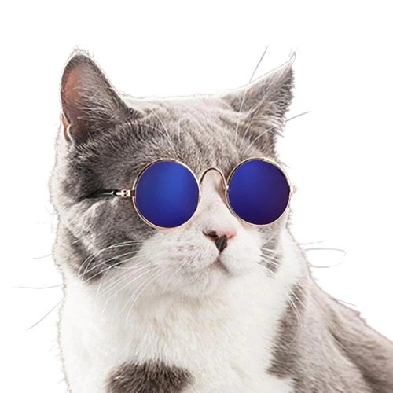
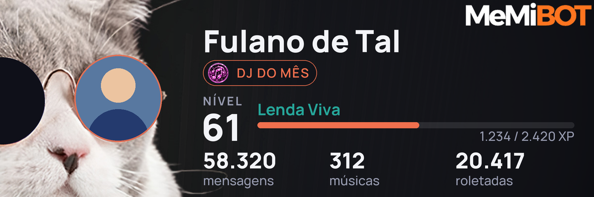
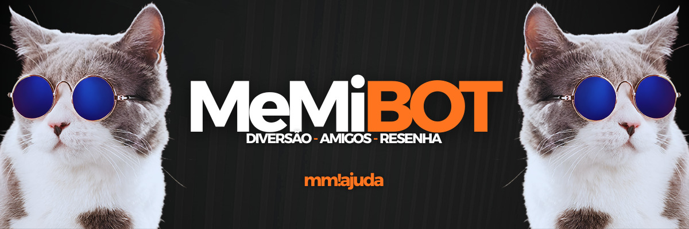
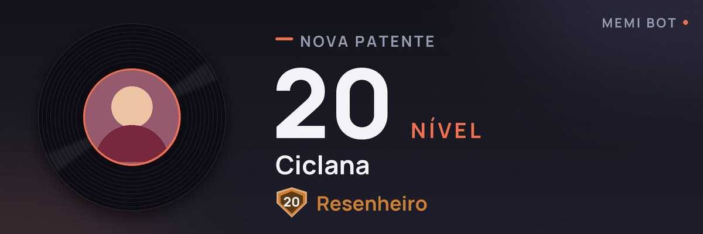
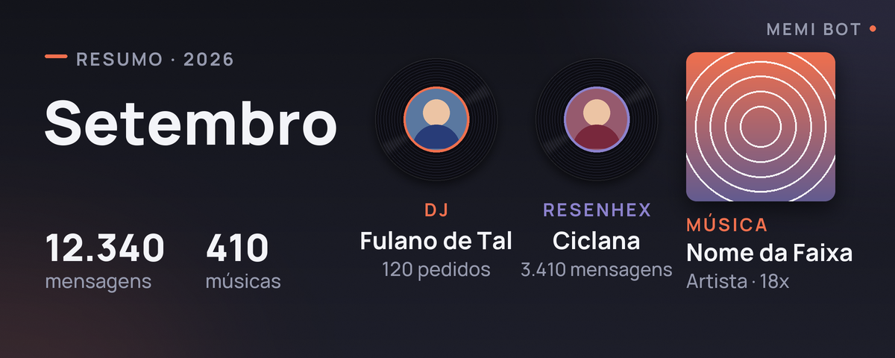
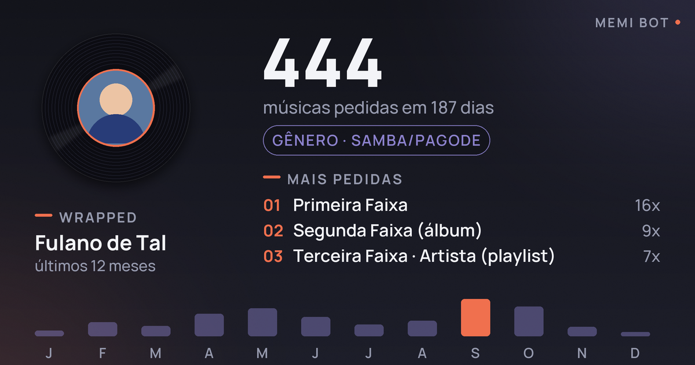

<div align="center">



# MeMi BOT

**Bot de engajamento para comunidades no Discord: transforma a conversa e a música do servidor em
rankings, níveis, conquistas e cartões gerados em imagem.**

[](https://www.python.org/)
[](https://discordpy.readthedocs.io/)
[](https://www.sqlite.org/)
[](https://python-pillow.org/)
[](.github/workflows/tests.yml)
[](LICENSE)



</div>

---

## O que é

O MeMi BOT nasceu para um servidor de amigos e cresceu até virar um bot completo de comunidade.
Ele acompanha, em tempo real, as mensagens e os pedidos de música feitos aos bots de música
(Pancake e Jockie), lê as rolagens do bot de jogos **Mudae** e converte tudo isso em:

- **rankings** de músicas, artistas, gêneros, mensagens e níveis, por mês, por ano ou no geral;
- **progressão**: níveis de 1 a 100 com XP e 11 patentes, de *Figurante* a *Demiurgo Supremo*;
- **conquistas**: tags que são ao mesmo tempo título e insígnia, automáticas ou concedidas pelo dono;
- **imagens** geradas com Pillow: cartão de perfil, level up, resumo do mês e *Wrapped* anual;
- **minijogos**: quiz "quem canta?", duelos mensais, sequência de dias e "nesta data".

Todo o texto da interface é em português do Brasil.

## Galeria

As imagens abaixo foram geradas pelo próprio código, com dados fictícios
(em [`docs/amostras`](docs/amostras/)).

| Ajuda (`mm!ajuda`) | Nova patente |
| --- | --- |
|  |  |
| **Resumo do mês (automático)** | **Wrapped (`mm!wrapped`)** |
|  |  |

**Patentes** (emblemas desenhados pelo bot, um a cada 10 níveis):


## Recursos

| Área | O que faz |
| --- | --- |
| Música | Reconhece pedidos (`m!play`, `p!play`…) e as faixas tocadas; ranking de faixas, artistas, gêneros e de quem mais pede; capas e gêneros via API pública do Deezer; `mm!aleatoria` sorteia uma faixa já tocada |
| Atividade | Contagem de mensagens por pessoa e por período, Top 1 rotativo, hall da fama dos meses e anos fechados |
| Progressão | XP = 1 por mensagem + 25 por música pedida + ½ por roletada; nível N exige `20 × (N − 1)²` XP; 11 patentes com emblema próprio |
| Tags | Catálogo em `tags.py` com 8 categorias (rankings, metas, Cartola, eventos, patentes e tags secretas); as insígnias viram emojis da aplicação automaticamente |
| Perfil | Perfil em páginas com botões, frase, música favorita, cor pessoal (`mm!ec`), cartão em imagem |
| Mudae | Leitura passiva de rolls, casamentos, kakera e *snipes*, com rankings por pessoa, personagem e série |
| Minijogos | `mm!quiz`, `mm!duelo`, `mm!comparar`, `mm!sequencia`, `mm!nestedia` |
| Automação | Resumo automático no fechamento de cada mês/ano, aviso de level up, alerta por DM ao dono após falhas repetidas |
| Operação | Backup diário comprimido (7 dias) + cópia semanal opcional, ícone na bandeja do Windows, reinício gracioso, `mm!status` |

## Destaques técnicos

- **Recuperação offline sem duplicar.** Ao ligar, reconectar e a cada 15 minutos, o bot relê o
  histórico dos canais a partir do último ponto confirmado. Mensagens, pedidos, roletadas e
  períodos fechados têm chaves únicas no SQLite, então reler o mesmo trecho nunca conta duas vezes.
- **Privacidade por projeto.** Mensagens comuns guardam apenas metadados (ID, autor, canal, se é
  bot), nunca o conteúdo. Só o texto dos pedidos de música é armazenado. Exportações com dados de
  membros são restritas ao dono, e os avisos desativam menções.
- **Avisos à prova de queda.** O envio é reservado no banco antes da chamada ao Discord, evitando
  avisos repetidos depois de uma reconexão.
- **Imagens com Pillow.** Composição de fundos, avatares, tipografia (Manrope + DejaVu Sans como
  fallback para outros alfabetos), barras de progresso e emblemas vetoriais, geradas em thread com
  timeout; se algo falhar, a mensagem sai em texto.
- **SQLite em modo WAL**, migrações automáticas com backup prévio e backup diário em thread
  própria, sem travar o bot.
- **Instância única** por trava de socket local: impossível abrir o bot duas vezes por engano.
- **Testes automatizados**: 324 testes com `unittest`, sem rede e sem Discord, executados
  no GitHub Actions em Python 3.10 e 3.12, junto com a checagem de formatação (`black`).

## Comandos principais

Prefixo `mm!` (aceita maiúsculas e acentos). Também há comandos de barra: `/perfil`, `/cartao`,
`/levels`, `/wrapped`, `/frase`, `/favorita`, `/cor`, `/titulo` e `/sequencia`.

| Comando | Descrição |
| --- | --- |
| `mm!musicas [artista\|ios\|genero] [mes\|ano]` | Rankings de música |
| `mm!tagarelas [mes\|ano]` | Ranking de mensagens |
| `mm!levels` | Nível, patente e XP de cada pessoa |
| `mm!perfil [@pessoa]` / `mm!cartao [@pessoa]` | Perfil em páginas / cartão em imagem |
| `mm!tags [@pessoa]` / `mm!tags todos` | Tags conquistadas / catálogo completo |
| `mm!wrapped` | Resumo musical dos últimos 12 meses |
| `mm!hall [mes\|ano]` | Vencedores dos períodos fechados |
| `mm!mudae [ios\|personagens\|series\|casamentos\|kakera\|snipes\|azar]` | Estatísticas do Mudae |
| `mm!quiz` · `mm!duelo @pessoa` · `mm!comparar @pessoa` | Minijogos |
| `mm!sequencia` · `mm!nestedia` | Dias seguidos conversando · o que aconteceu nesta data |
| `mm!ec COR` · `mm!frase TEXTO` · `mm!favorita MÚSICA - ARTISTA` | Personalização |
| `mm!changelog [versão]` | Histórico de versões |

Comandos do dono/admins: `mm!read`, `mm!scan`, `mm!give`, `mm!exportar`, `mm!status`,
`mm!mudaedump`, `mm!mudaenome`, `mm!reiniciar`. A lista completa e o detalhe de cada comando estão
no [LEIA-ME.md](LEIA-ME.md).

## Instalação

Requisitos: Python 3.10+ e um aplicativo de bot criado no
[Discord Developer Portal](https://discord.com/developers/applications), com a
**Message Content Intent** ativada (a **Server Members Intent** é recomendada).

```powershell
git clone https://github.com/GuiMatz/memi-bot.git
cd memi-bot
python -m venv .venv
.\.venv\Scripts\Activate.ps1
python -m pip install -r requirements.txt
Copy-Item token.txt.example token.txt
Copy-Item config.example.json config.json
python memi_bot.py
```

### Configuração

Nenhum segredo fica no código. Tudo vem de arquivos locais ignorados pelo Git
(ou de variáveis de ambiente):

| Onde | Chave | Para que serve |
| --- | --- | --- |
| `token.txt` | — | Token do bot, sozinho, sem aspas |
| `config.json` | `owner_id` (ou `MEMI_OWNER_ID`) | ID do dono (comandos administrativos e alertas por DM) |
| `config.json` | `notice_channel_id` (ou `MEMI_NOTICE_CHANNEL_ID`) | Canal dos avisos e resumos automáticos |
| `config.json` | `guild_id` (ou `MEMI_GUILD_ID`) | Servidor (opcional se o bot está em um só) |
| `config.json` | `admin_ids` | Lista opcional de IDs com os mesmos comandos do dono |
| `config.json` | `backup_extra_dir` | Pasta opcional que recebe um backup por semana |
| variável | `MEMI_MEMBERS_INTENT=0` | Roda sem a Server Members Intent |

O bot cria o `memi.db` (SQLite) na primeira execução. Banco, logs e backups contêm dados do
servidor e **nunca** devem ser publicados (já estão no `.gitignore`).

Para rodar com ícone na bandeja do Windows: `python -m pip install -r requirements-tray.txt` e
`python memi_tray.py` (ou dois cliques em `INICIAR.bat`).

## Testes

```powershell
python -m unittest discover -v -p "test_*.py"
```

Os testes usam bancos temporários e objetos simulados: não conectam ao Discord nem a APIs. Cobrem
contagens, XP, níveis, patentes, tags, emojis, Mudae, fechamento de períodos, migração, backups,
reconexão, permissões, geração de imagens e a manutenção periódica.

## Estrutura

```text
memi_bot.py      núcleo: eventos, leitura do histórico, comandos e manutenção
banco.py         camada SQLite: esquema, migrações, consultas e backups
extras.py        quiz, duelos, sequências, "nesta data", status e comandos de barra
mudae.py         leitura das mensagens do Mudae e rankings
imagens.py       geração das imagens com Pillow
estilo.py        embeds, cores e emojis das mensagens
progressao.py    XP, níveis e patentes
tags.py          catálogo de tags (títulos + insígnias)
emojis.py        sincronização dos emojis da aplicação
changelog.py     histórico de versões (mm!changelog)
memi_tray.py     ícone na bandeja do Windows
assets/          fontes, banners, logo e insígnias
docs/amostras/   imagens de exemplo geradas com dados fictícios
test_*.py        suíte de testes (unittest)
```

## Notas

- O changelog cita o **FUT.AE**, um jogo de coleção de futebol que foi desenvolvido junto com o
  bot e depois separado em outro projeto; ele não faz parte deste repositório.
- Nesta versão pública, insígnias com fotos de pessoas reais foram removidas; essas tags usam o
  emoji padrão (o bot já trata a ausência da imagem).
- O `mm!exportar` e o `mm!mudaedump` geram arquivos com nomes de membros: use apenas no seu
  servidor e não os publique.

## Licença

Distribuído sob a licença [MIT](LICENSE). As fontes em `assets/fonts` têm licenças próprias
(Manrope — OFL; DejaVu — licença livre), incluídas ao lado delas.

Contribuições são bem-vindas: veja o [CONTRIBUTING.md](CONTRIBUTING.md) e o
[Código de Conduta](CODE_OF_CONDUCT.md).
